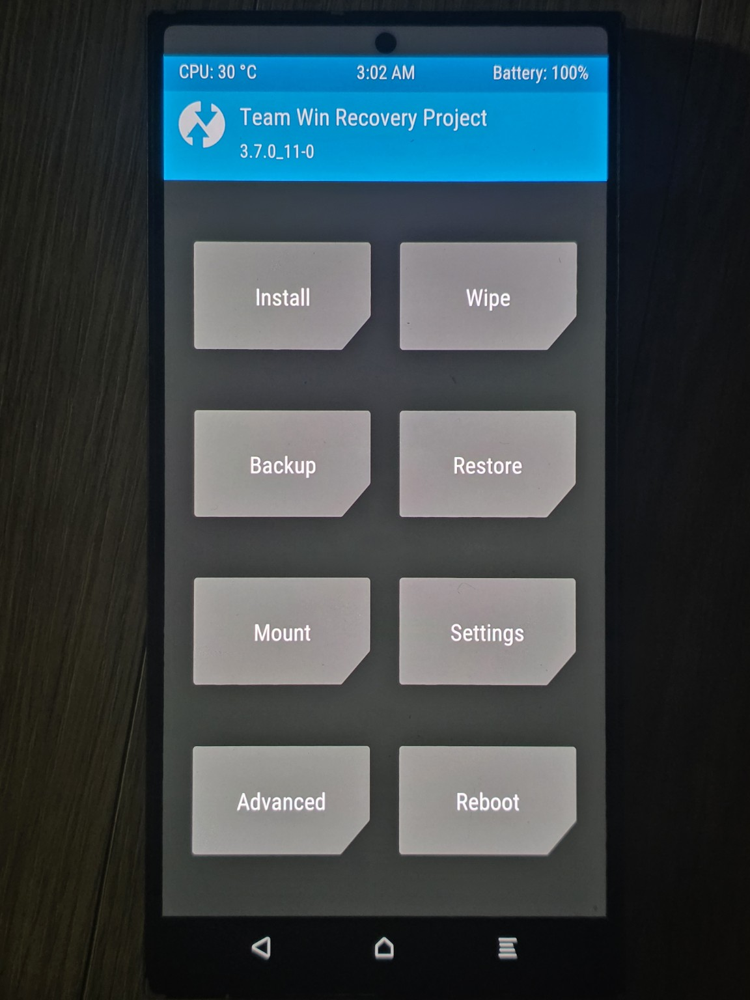

# SM-N986B TWRP RAM boot

RAM-booting TWRP 3.7.0 on the Exynos Galaxy Note20 Ultra (SM-N986B) through S-Boot Fastboot and UEFI, with build notes, validation evidence, and documented limitations.

**한국어 요약:** `SM-N986B / N986BXXU0ATE3` 실기기에서 S-Boot Fastboot를 거쳐 UEFI와 Linux 복구 이미지를 RAM으로 실행했습니다. TWRP `3.7.0_11-0` 메뉴와 터치 조작을 확인했습니다. 이 시험 이미지에서는 저장장치를 비활성화했으며 Mount 목록은 비어 있습니다.

## Observed result

| Gate | Result |
| --- | --- |
| Tested phone and bootloader | `SM-N986B`, `N986BXXU0ATE3` |
| Transfer | 162,560 × 512-byte payload packets; 162,570 acknowledged OUT transfers in the saved run |
| Boot path | Android → S-Boot Fastboot → RAM-loaded EDK II/UEFI → Exynos990 Linux recovery → TWRP |
| TWRP | `3.7.0_11-0` GUI displayed; touch navigation observed |
| Upload-mode verification | FD and package stream matched two RAM reads and the sent source |
| Storage | UFS, RPMB and DWMMC disabled in the tested FDT; Mount list empty |
| Return to Android | A later ADB receipt reported boot complete, warranty bit `0`, Verified Boot `green` |

The [Mount screen](evidence/photos/twrp-mount.jpg) and [File Manager in `/dev`](evidence/photos/twrp-file-manager.jpg) show the scope of the demonstrated UI. No partition mount, backup, restore, recovery ADB/MTP, or permanent installation was validated.

## Read in order

1. [Porting design and memory map](docs/PORTING.md)
2. [Exact tested profile and replay sequence](docs/REPLAY.md)
3. [Evidence and limits](docs/EVIDENCE.md)
4. [Inputs, provenance and publication status](docs/SOURCES_AND_RELEASE.md)
5. [Windows x86, x64 and Arm64 builds and USB setup](docs/WINDOWS.md)

Run `python scripts/verify_public_evidence.py` to check the staged photos and public evidence manifest. If you hold the original local build outputs, `python scripts/verify_public_evidence.py --artifacts <directory>` also verifies the frozen FD, stream, EFI, FDT and initramfs hashes. This command performs no device I/O.

## Repository status

This is a **launcher, documentation and evidence release candidate**. The new standalone launcher reproduces the pinned USB packet sequence and passes offline checks against the frozen UI10V bytes. It has not yet been run on the phone. The Linux/TWRP image, Samsung-derived DT/ECT material, raw RAM dumps and device receipts are not bundled here. A clean checkout cannot replay the boot until the exact private FD and stream are supplied locally. Independent source rebuilding also remains incomplete. The [release checklist](docs/SOURCES_AND_RELEASE.md) names the remaining work.

Windows candidate ZIPs contain x86, x64 or arm64 launchers with matching libusb DLLs and the documentation. They require Android SDK Platform-Tools, a WinUSB-bound Fastboot interface, and the exact local FD/stream. See the [replay steps](docs/REPLAY.md).

The original TWRP image was obtained from [Team Win's `c2s` download page](https://dl.twrp.me/c2s/). Team Win's page asks users not to mirror its images. The recovery source is available from [Team Win](https://github.com/TeamWin/android_bootable_recovery). This repository does not redistribute a TWRP image.

Original code and documentation are [MIT licensed](LICENSE); the three evidence photographs and all third-party inputs are excluded. See [source notices](NOTICE.md).
